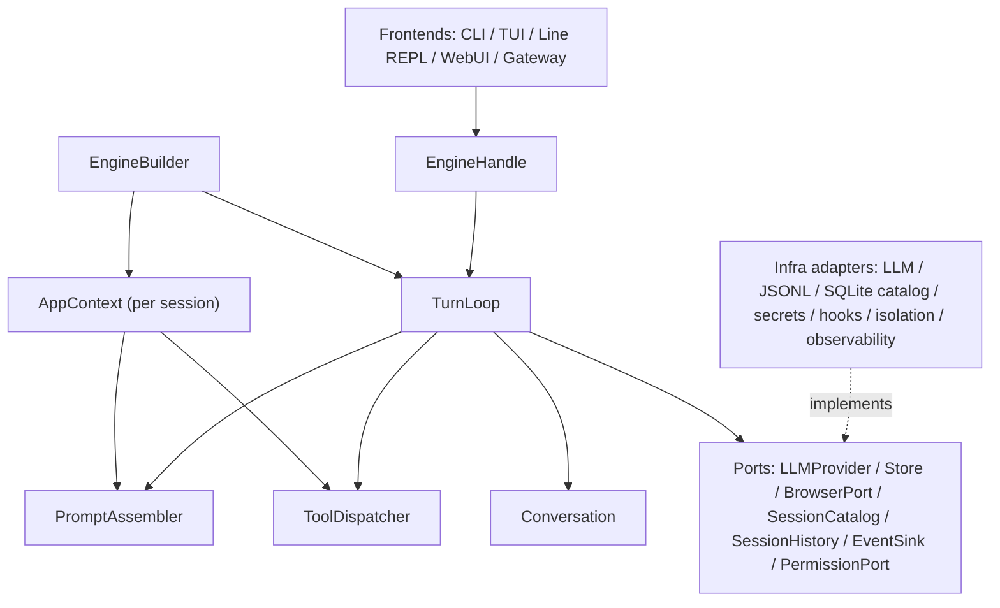

# 运行时组件地图

> 当前事实来源：`src/autoverse/app/builder.py`、`src/autoverse/app/context.py`、`src/autoverse/core/`、`src/autoverse/ports/` 和 import-linter。
> 维护规则：组件责任、装配位置、公开端口或生命周期范围变化时必须同步。

本页说明主要组件如何装配、依赖和存活。精确字段、命令和 API 仍以对应 reference 和代码为准。

## 背景

AutoVerse 把 agent 行为、外部能力和用户界面分开。`core` 定义稳定执行骨架，`ports` 定义它需要的窄接口，`app` 在 session 创建时选择并注入具体 adapter，frontends 只通过公开 handle 和事件流交互。

## 当前结构

| 组件 | 主要责任 | 默认生命周期 | 不负责 |
|------|----------|--------------|--------|
| `EngineBuilder` | 读取已合并配置和 options，创建 session 依赖图 | engine/session 创建阶段 | agent 循环和 UI 渲染 |
| `AppContext` | 保存该 session 已注入的 store、events、tools、prompt、jobs 等共享依赖 | 每 session | 从磁盘发现或创建依赖 |
| `TurnLoop` | 运行模型、工具、压缩和 StopGate 循环并发出事件 | 每 session，多 turn 复用 | 选择具体 provider/store/frontend |
| `Conversation` | 维护 session 的权威消息视图，并通过 `Store` store-first 持久化 | 每 session | UI block、trace 或 job 状态 |
| `PromptAssembler` | 按固定顺序渲染主 agent system prompt | 每 session | 探测环境、读文件或调用模型 |
| `ToolDispatcher` | schema、plan gate、permission、事件、取消、timeout 和错误包装 | 每 session | app 层 hook 包装及文件工具特有的路径/stale-read 语义 |
| `EngineHandle` | 给 frontend 暴露运行、终止、清空、压缩和模型切换 | 每 session | 暴露 core 私有对象 |
| `EventSink` | 消费结构化 `StreamEvent` | 每 session/订阅 | 保存会话消息或决定 loop 是否继续 |
| `SessionBridge` | 保存 WebUI 可寻址展示块，发布有界 snapshot/history page、lazy resource 和 live delta | 每 Web session/进程 | 保存权威会话消息或控制 TurnLoop |
| `SessionCatalogPort` | 查询 rail projection，原子维护 pinned/last-viewed | 进程共享、调用级连接 | 保存 Conversation 或工具状态 |
| `SessionHistoryPort` | 按完整 turn 读取 tail/before 消息窗口 | view session/history 请求 | 裁决消息写入或 engine 控制状态 |
| `NativeBrowserBroker` | 把 WebKit host 连接映射成 session-scoped `BrowserPort`，关联命令并把 revision 一致的观察值解码为共享类型 | Web 进程/host 连接 | 保存网页、活动页、cookie 或浏览器控制真相 |
| `BrowserHostController` | 在 Apple 进程持有有序 WKWebView 页面集合、稳定 page id、单调导航 revision、profile、可见性和用户/agent 控制权，并生成语义观察 | Apple App 进程 | 对话循环、工具权限或会话消息 |

## 边界规则

- `frontends` 只面向 `EngineHandle`、查询/交互 port 和事件，不读取 engine 私有字段。
- `app` 是唯一可以同时知道 core 和具体 infra adapter 的装配层。
- `PreToolUse`/`PostToolUse` 由 app 层 middleware 包住 dispatcher 的 per-call 路径；hook deny 在 route/schema/plan/permission 前短路。
- `core` 只能依赖 `types`、`ports` 和 sibling core；外部资源通过注入进入。
- `AppContext` 是 session 级依赖容器，不是全局 service locator；新能力应先判断是否需要窄 port。
- trace、Web block log 和 sidebar state 是事件派生视图，不能反向成为 TurnLoop 控制输入；
  sidebar 冷恢复重放 Store 中的 assistant usage/tool-result metadata，trace 只补累计和旧格式。

## 生命周期范围

| 范围 | 典型对象 |
|------|----------|
| 进程级 | 配置来源、全局数据目录、Web server、SQLite session catalog、native browser broker、可共享 registry 定义 |
| view session 级 | Web `SessionBridge`、有界历史窗口、资源页缓存；可在 engine 之前存在 |
| engine/session 级 | `AppContext`、`Conversation`、`TurnLoop`、`PromptAssembler`、tool registry、trace collector、job table、`BrowserPort` proxy 或 Playwright browser session |
| turn 级 | 用户消息、LLM request、accumulator、gate decision、可选 workspace snapshot |
| tool call 级 | tool args、permission decision、abort/timeout、`TOOL_START`/`TOOL_END` |
| 连接级 | Web SSE subscriber queue、原生 browser-host WebSocket；断线不会改变 session 消息真相，host 断线会让其 browser proxy 返回 `browser_unavailable` |

## Prompt 装配顺序

`PromptAssembler` 不读取环境或文件，只按固定顺序组合 app 已注入的字符串。当前顺序是：

| 顺序 | 内容来源 |
|------|----------|
| 1 | core 固定行为、方法、工具使用和风格 sections |
| 2 | 从 `ToolRegistry.schemas()` 派生的工具摘要 |
| 3 | 固定子代理协作说明 |
| 4 | 按名称排序的 extension prompt fragments |
| 5 | interactive/one-shot session guidance |
| 6 | compaction awareness 和 system behavior |
| 7 | app 层探测后注入的 environment |
| 8 | `MemoryLoader` 组装的项目记忆 |
| 9 | 配置与本次 options 的附加指令 |

顺序本身是运行时契约：新增 prompt 来源时必须先确定唯一 owner、注入位置和是否会泄露被动观测信息。完整 prompt 文本仍以 `src/autoverse/core/prompt/sections.py` 为准，不在文档复制。

## 相关代码

- `src/autoverse/app/builder.py`
- `src/autoverse/app/context.py`
- `src/autoverse/core/loop/turn_loop.py`
- `src/autoverse/core/prompt/assembler.py`
- `src/autoverse/core/tools/dispatcher.py`
- `src/autoverse/core/state/conversation.py`
- `src/autoverse/ports/__init__.py`

状态归属见 [`state-ownership.md`](state-ownership.md)，逐步运行路径见 [`runtime-flow.md`](runtime-flow.md)。
