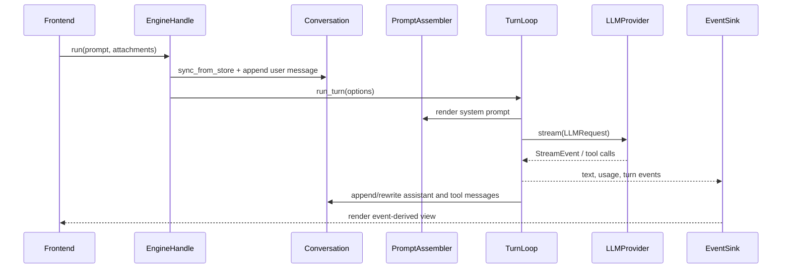
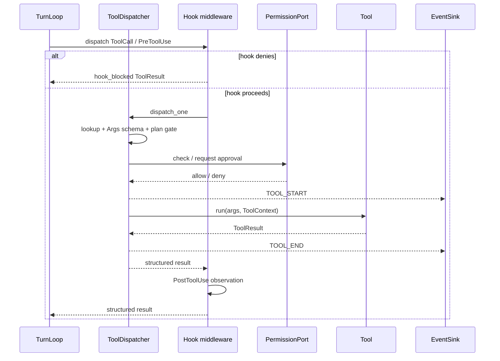
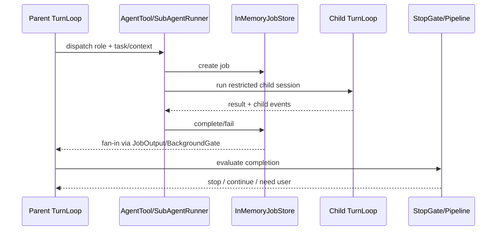
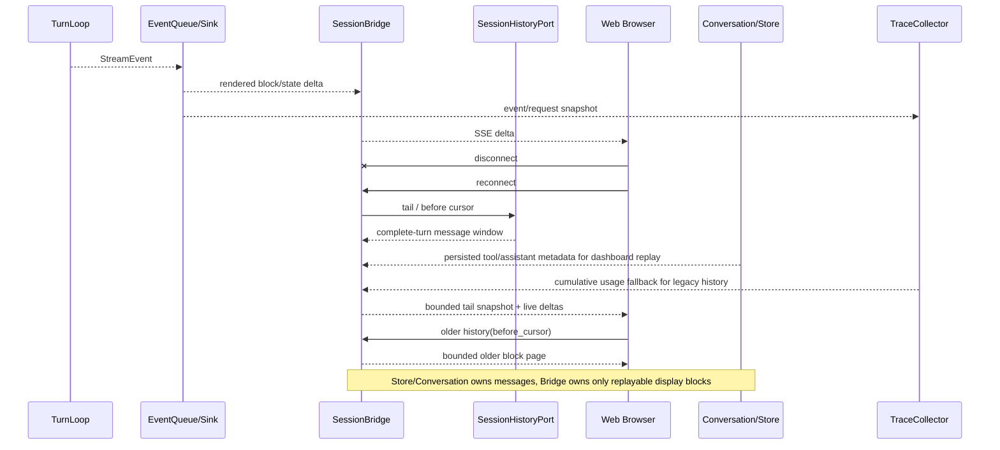

# 运行路径

> 当前事实来源：`src/autoverse/`、`pyproject.toml`、import-linter 和 contract tests。
> 维护规则：分层、端口、入口、导入边界或真相源位置变化时必须同步。

本页按一次用户请求说明 AutoVerse 的主要数据流。

## 总体时序

## 1. 前端提交输入

CLI、TUI、Line REPL 或 WebUI 收集用户输入。普通文本进入 engine；`/` 开头的内容先由命令注册表处理。

WebUI 普通 turn 在追加用户消息前捕获一个工作区快照，并将唯一 `rewind_id`
和 snapshot hash 绑定到该用户消息。编辑或撤销已发送指令时，Web adapter 先
abort 并等待活动 turn、待审批/提问和后台子代理完全退出，再按同一锚点恢复
工作区；只有文件恢复成功后才把 Conversation 截断到该用户消息之前。随后
engine 恢复 turn 前的 plan/goal 状态，并从保留的用户消息重算自动标题和会话
活动元数据；用户手动锁定的标题不变。这个顺序保证文件、模型上下文和会话
派生状态不会形成半回退状态。

回退只覆盖 AutoVerse 持久化的对话/工作流状态和快照管理的本地工作区。已经
发生的模型 usage、trace 审计记录以及工具造成的远端外部副作用仍保留。

命令可能只显示文本，也可能展开成 prompt，再提交给 engine。

WebUI 的只读打开路径先于本节的 runtime 输入：`POST /api/sessions` 创建或复用 view
session，从 `SessionCatalogPort` 取得导航 projection，并由 `SessionHistoryPort` 从 JSONL
尾部反向读取最近两个完整 turn。SSE 立即建立在该有界投影上；更早 turn 用 opaque cursor
按需读取。此时 provider、tools、permission、trace 和 Conversation/TurnLoop 尚未装配。

## 2. EngineBuilder 装配运行时

`EngineBuilder` 把配置、密钥、模型 provider、工具注册表、权限、store、prompt assembler 等依赖注入 `AppContext` 和 engine。

WebUI 只在消息、运行时命令或 mode 操作首次需要时激活 engine。view session 已加载的
Store-derived messages 用于 seed Conversation，避免同一打开路径重复读历史。普通 turn
仍在 append 前 `sync_from_store`；compact、clear、rewind 和共享命令分发先
`sync_history`，所以有界 view cache 不参与跨进程裁决。

这个阶段是外部世界进入 core 的边界。

Apple App 连接 WebUI server 后，同时以 `/api/browser/host` WebSocket 注册一个可见的
WKWebView。首次激活 engine 时，`SessionManager` 若观察到 host 已连接，就把会话级
`BrowserPort` proxy 注入 `EngineOptions`；否则仍使用配置派生的 Playwright backend。
原生 host 和 Playwright adapter 各自在 frontend/infra 层持有有序页面集合与活动
`page_id`；core 工具只传递显式目标或使用活动页，不保存第二份页面状态。
浏览器工具调用经 proxy 串行发送到原生进程，结果、错误和截图再回到普通 `ToolResult`
路径。页面动作完成后只调用一次 `observe_page`：adapter 在同一 navigation revision 内采集
page id、URL、标题、loading、active、受限语义 DOM 快照和按策略选择的截图，再以不可变
`BrowserPageObservation` 返回。观察期间页面变化会重试一次，持续变化则只把观察标为不可用，
不会把旧 DOM 与新 URL/截图拼接。真正需要取图时，adapter 在同一 revision 内以 1100ms
资产上限等待 DOM、字体和首屏图片，再等待两个绘制帧（另有 150ms 兜底）；它不使用可能永不结束的
`networkidle`。TurnLoop 不知道页面位于哪个进程。

Apple host 仍是页面集合与活动页的权威所有者。每个 WebUI turn 开始时，session proxy 以
有上限的 `list_pages` 读取刷新 compact 派生快照；它比较页面 id 集合、活动 id，以及每页
revision、URL、标题和 loading 状态。因此同一 URL reload、同一标签导航、异步重定向/加载完成、脚本改标题和标签开关
都能触发状态通知，而不只检测标签切换；新 session 的首次快照也会告知模型已有页面，而
不是静默建立基线。Web adapter 把变化类别和相关 page id 附加为仅供
模型请求使用的上下文，并要求先调用 `browser_list_pages`、再以显式 `page_id` 继续操作。
TurnLoop 只在构造 provider request 时前置通知；持久化的人类文本、标题、回放和压缩仍看
到原始消息。页面可视状态因此不会在 agent 侧继续停留在上一份工具结果。

## 3. TurnLoop 运行一轮

`core/loop` 负责：

- 组装 system prompt 和历史消息。
- 调用 `LLMProvider`。
- 消费模型流。
- 处理工具调用。
- 根据 StopGate 判断是否继续。
- 发出 `StreamEvent`。

TurnLoop 不知道 provider 是 OpenAI wire、OpenRouter、DeepSeek 还是 mock。

### 上下文预算与压缩

每次 provider 调用前，TurnLoop 先构造完整 `LLMRequest`。预算包含 system
prompt、消息、tool schemas、图片名义成本、输出预留和安全余量，而不是只统计
conversation 消息。超过阈值时依次尝试工具噪音折叠、替换式 rolling summary 和
按 token 预算的紧急截断。

rolling summary 的 text/thinking 流只在压缩器内部消费；其 `USAGE` 事件仍进入公共
事件流和 trace meter，因为摘要和失败重试都是实际计费的 provider 调用。

被移除的消息必须先通过 `CompactionArchivePort` 持久化并脱敏，成功后
`Conversation.rewrite` 才能删除原文。压缩后重新构造并测量 request；成功结果必须
实际减少 token。模型通过 session-scoped 的 catalog、grep、FTS search 和分页 read
调查归档内容；确定性 list/grep/read 是恢复底座，search 只是辅助召回。

trace 只记录 archive segment id、数量、hash 和摘要等观测信息，不保存或控制被
压缩的原始上下文。

## 4. 工具调用

模型请求工具时，app 装配的 hook middleware 包住 `ToolDispatcher` 的单调用执行链：

1. 普通 per-call 路径先运行 `PreToolUse`；deny 会在 dispatcher 前短路。
2. dispatcher 路由到注册工具并用工具 `Args` schema 校验参数。
3. 检查 plan mode、能力等级和权限。
4. 发出 `TOOL_START`。
5. 用 abort、timeout 和错误包装执行 `tool.run(args, ctx)`。
6. 发出 `TOOL_END`；返回 dispatcher 后再运行 `PostToolUse` 旁路观察。

路径解析和隔离映射由 `ToolContext` 提供给工具使用；读后写、stale-read 和
相对路径逃逸检查由文件类工具执行。进入 worktree mode 后，loop/app 更新 live
`cwd` 和 isolation mapping，dispatcher 不直接实现 worktree 规则。

工具结果以统一结构返回给模型和前端。

文件类工具在 `tool.run` 内通过 `ToolContext` 完成路径解析、read-before-write 和 stale-read 检查；这些语义不属于 dispatcher 的通用外壳。

浏览器类工具在 `tool.run` 内先做 URL scheme/地址护栏，再调用 `BrowserPort`。原生可见
host 只额外允许 loopback，便于本地应用测试；其它 private、link-local、reserved 与
metadata 目标仍被拒绝。列举页面是只读状态查询，不改变原生分栏可见性；新建、切换和
其它实际页面操作会显示分栏。网页请求新窗口时，WKUIDelegate 把它注册为新页面并激活，
而不是重定向当前页。用户在浏览器栏选择接管后，host 用结构化 `user_control` 错误
拒绝 agent 操作；聊天 WebView 提交下一条有效用户消息时，通过进程内事件自动恢复 agent
控制。该事件不经过 BrowserPort，也不改变 turn 或消息的权威所有者。

`browser_evaluate` 把同步表达式或显式顶层 `return await ...` 函数体交给 adapter；adapter
在有界时间内等待异步函数体，只允许 JSON 兼容最终值跨 `BrowserPort`。Playwright 使用会话
browser timeout，Apple host 在 WebKit 进程内限制为 30 秒。WebKit 的 unsupported-result
错误在 Apple 源头转换为稳定 `unsupported_result`，Python broker 不匹配本地化错误文本；
成功值在 core 工具边界以严格 JSON 形成模型可见文本。

provider 流中的 `TOOL_START` 和 `TURN_END` 是单次 LLM iteration 的内部控制事件：
accumulator 用它们组装 assistant message 和 stop reason，但不直接转发给公共事件流。
公共 `TOOL_START` 由 dispatcher 在权限判定后发出，公共 `TURN_END` 由 TurnLoop 在完整
user turn 结束时发出，因此前端和 trace 对一次执行只观察到一组配对工具事件和一个
turn 终止事件。

## 5. 子代理和工作流

子代理通过同一套 loop 和工具系统运行，只是有独立上下文、工具过滤和可选 worktree 隔离。

工作流通过 StopGate 或 Pipeline 约束完成条件，把“模型说完成了”升级为“机制确认可以停”。

## 6. 前端渲染和持久化

前端消费 `StreamEvent` 并渲染：

- TUI 转成 Textual/Rich 组件。
- Line REPL 转成 append-only 文本。
- WebUI 转成 SSE 块和浏览器 DOM。

`Conversation` 通过 `Store` 保存消息和语义会话元数据；写入成功后 app 更新
`SessionCatalogPort` 的 rail projection。catalog 自己拥有 pinned/last-viewed，projection
可以按 Store mtime 修复。独立 task/job adapter 保存各自状态；trace collector 从事件和
request snapshot 派生时间线、usage 和错误信息。它们服务恢复、回放和调试，但不共享一张
模糊的状态表。

dashboard replay 不把 trace 变成运行控制面：新 assistant message 保存单次 request usage
metadata，Store 足以恢复精确 Context；trace 只补累计计费和旧会话 whole-turn fallback。
Todo/Changed 同样从已持久化 tool result metadata 派生。任何缺失都以 unavailable 显式呈现，
不能把新 sink 的默认零值发布成历史统计。

组件生命周期见 [`component-map.md`](component-map.md)，权威状态和派生视图见 [`state-ownership.md`](state-ownership.md)。
