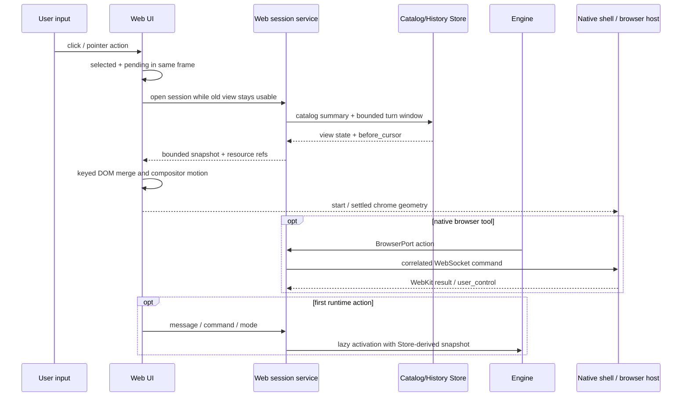

# 前端交互响应与运动设计

> 当前事实来源：`docs/reference/webui-api.md`、`docs/architecture/frontend-adapters.md`、
> `docs/architecture/state-ownership.md`、`src/autoverse/frontends/web/` 和 `apple/`。
> 维护规则：交互性能目标、导航/加载边界、运动取舍、Apple 壳同步协议或开放设计问题变化时同步。

## 背景

AutoVerse 的 WebUI 同时承担浏览器前端、macOS/iOS WebView 内容和远程客户端界面。
实现需要同时保证跨前端语义一致、会话可恢复和 SSE 可 replay。当前 Web adapter 已把
输入确认与较慢副作用分开：会话选择先进入 pending，旧 stream/正文保留到目标 session
可用；首次 snapshot 是有界尾页，图片通过 resource reference 懒加载；会话分组和 poll
复用已有 inventory。侧栏先一次提交最终 grid，再用 transform/opacity 播放面板运动，
原生桥只接收 start/settled 几何。

冷会话的只读浏览已经与 engine activation 解耦：view session 通过 catalog 和
`SessionHistoryPort` 反向读取最近两个完整 turn，发送消息、运行命令或切换运行模式时才
装配 engine；view 已读的消息快照直接作为初始 Conversation 视图，turn 开始仍从 Store
同步。pinned/last-viewed 和 rail projection 由 SQLite WAL catalog 原子维护，不再为查看或
置顶重写 JSONL transcript。



“不丝滑”包含两个必须分开治理的维度：

- **响应性**：输入后多久出现可见确认、选中态、骨架或内容。
- **运动质量**：动画是否连续、是否只触发合成、原生与 Web 是否同相、结束位置是否稳定。

提高模型速度、HTTP 吞吐或 Python 执行速度不能自动解决这两个维度。前端必须在输入发生
的同一帧确认用户意图，再让数据加载在不阻塞交互反馈的路径上完成。

## 当前契约与性能目标

### 交互性能口径

所有交互使用同一组时间点，不用“接口很快”替代用户可见指标：

| 时间点 | 定义 |
|--------|------|
| `input` | pointer/key 激活事件进入前端 |
| `ack` | pressed、selected、pending 或展开目标首次可见 |
| `useful` | 目标内容、可操作骨架或明确错误首次可见 |
| `settled` | 动画结束，布局和原生 chrome 不再继续校正 |

在发布构建、60 Hz 显示器和本地 server 上，目标为：

| 指标 | p95 目标 | 约束 |
|------|----------|------|
| `input -> ack` | 不超过 1 帧 | 不等待 HTTP、磁盘、engine 或 SSE |
| 本地 toggle `input -> useful` | 50 ms 内 | 分组、tab、菜单、折叠等纯展示动作 |
| 已缓存会话 `input -> useful` | 100 ms 内 | 先恢复可见窗口，不要求全历史已加载 |
| 冷会话骨架 `input -> useful` | 100 ms 内 | engine 尚未激活也必须有稳定反馈 |
| 冷会话最近内容可见 | 300 ms 内 | 历史资源不内联，超大块允许占位 |
| 面板 `ack -> settled` | 160–220 ms | 动画期间不产生超过 50 ms 的主线程任务 |
| 首次交互后的主线程阻塞 | 500 ms 窗口内无 `>50 ms` long task | WebKit 不支持 Long Tasks API 时用 rAF gap 代替 |

远程模式不承诺固定的内容到达时间；其目标是 `input -> ack` 仍不超过一帧，内容可见时间
不超过一次实际网络往返加 150 ms 客户端处理预算。断网时不能以永久 spinner 代替错误。

### 状态边界

目标架构继续遵守现有单一真相源原则：

- `Conversation` + `Store` 仍是会话消息真相。
- engine/TurnLoop 仍是运行、工具和 workflow 控制状态真相。
- Web transcript、选中项、骨架、滚动位置和最近渲染缓存仍是派生视图。
- Apple 壳不拥有 session/agent 真相；它拥有窗口、原生 chrome，以及独立工具浏览器的
  WKWebView 页面集合/profile/control owner。稳定 page id、标签顺序和活动页也由
  `BrowserHostController` 持有；Python broker 只保存连接、pending command 和结果派生的
  最近活动 id。

为了避免微小 UI 元数据重写整个 transcript，当前实现把会话数据分成两类：

| 数据 | 目标所有者 | 更新特征 |
|------|------------|----------|
| 消息和语义 session meta | `Store` | append/rewrite，与 turn 一致性绑定 |
| pinned、last-viewed、rail activity projection | `SessionCatalogPort` | 小字段原子更新和索引查询 |

`SessionCatalogPort` 的默认本地 adapter 使用 Python 标准库 SQLite 的 WAL 模式，支持多进程
读写、小记录更新和按更新时间/工作目录查询。catalog 中可从 Store 重建的 summary 是派生
索引；pinned 和 last-viewed 是 catalog 自己的权威字段。catalog 损坏时必须保留 transcript，
并允许从 Store 重建 summary；不能让导航索引故障删除或改写会话消息。

对应的当前契约分别记录在 `SessionCatalogPort`、SQLite adapter、app 装配、
`docs/architecture/state-ownership.md` 和存储契约测试中。

## 关键取舍

### 输入确认先于副作用

每个交互控件都采用显式状态机：

```text
idle -> pressed -> pending? -> selected/open/closed
                         \-> error -> stable previous state
```

- `pointerdown` 或键盘激活在同一帧产生 pressed 反馈。
- 可取消导航立即更新本地 selection，并用 action sequence/abort signal 保证 latest-wins。
- pending 表示数据未完成，不表示按钮没有收到点击。
- 失败时保留旧的可用内容，回滚目标 selection，并在目标附近提供可重试错误。
- destructive 或不可并行的动作才在 pending 时禁用；普通导航允许用户继续切换。

会话行和分组头使用真实 button/可选择控件语义，不以只有 delegated click 的普通 `li`
代替交互元素。pressed、focus-visible、disabled 和 aria-busy 必须来自同一状态机，鼠标与
键盘不能走两条不同的反馈路径。

Browser 分栏的显示/隐藏和 **Take Over** 必须在本地同一帧确认，不等待 WebSocket 或
engine。标签新建、切换和关闭也在本地更新；用户切换页会先取得控制并取消执行中的 agent
命令，避免命令目标在交互中漂移。活动标签在溢出时按共享 state motion 滚动到可见区域，
系统开启 reduced motion 后不播放该位移动画。切换只在稳定原生容器中替换已保存的
WKWebView，不重新创建页面；标签标题在页面脚本动作结束后回写快照，避免选中内容与标签
元数据短暂分离。隐藏时保留页面，纯 `list_pages` 查询不能触发展示动画。
控制权反馈必须保持局部和可读：agent 空闲控制使用低对比琥珀描边，实际页面命令运行时才让
相关地址栏或页面边缘、活动标签圆点和状态动作文字按 activity token 呼吸；用户接管立即切换
为绿色静态反馈。`list_pages` 不触发 activity；快速命令在结束或失败后补足到 800ms 可见下限，
后续命令直接替换动作，用户接管或断线立即清除。工具栏用固定宽度动作胶囊提供首帧可读反馈，
不改变地址栏布局。reduced motion
下取消呼吸，只保留描边、颜色和文字，不能仅靠颜色表达控制权。活动图标与普通图标使用固定
尺寸交叉淡入，开始和结束使用短 state 淡变；呼吸不得驱动布局，也不得给整个 Browser surface
施加逐帧动态阴影。
接管期间 host 立即把控制 owner 切到 user；随后到达的 agent command 返回
`user_control`，而不是排队后突然操作页面。浏览器栏不常驻交还按钮；用户在聊天区提交
下一条有效消息时，本地 bridge 先恢复 agent owner，再发送 Session HTTP 请求，使随后的
浏览器命令无需竞态重试。提交失败可以留下 agent owner，但不会启动 turn 或操作页面。
turn 边界随后通过一次有上限的只读页面列表刷新来解释可见页面变化：host 保持页面集合、
revision/URL/title/loading 和活动页真相，proxy 只比较最近 agent 已知的 compact 快照，并把差异作为
LLM-only context 注入。模型必须先重列页面并以显式 `page_id` 继续目标操作；通知不渲染为
用户正文，对账故障也不能拖住 turn。普通页面动作在同一次结果中返回一个 revision 校验的
最终页面状态与 bounded 语义快照；text-only 模型不为自动反馈截图或等待视觉模型，vision
模型只在 host 判定页面以视觉内容为主时自动收到截图，显式截图才无条件承担视觉分析延迟。
实际取图前的视觉稳定等待共享 1100ms 资产上限并追加两个绘制帧与 150ms 帧兜底，不等待 `networkidle`；
普通 text-only 自动反馈不进入这条路径，视觉页面和显式截图也不会被持续网络请求无限阻塞。
可能触发导航的页面动作只等待短 commit window：检测到导航后最多等待 bounded DOM ready，
超时则返回成功动作与 `is_loading`，把进一步等待交给显式 `browser_wait`，避免无导航动作
普遍变慢，也避免可见页面被错误归类为交互失败。
原生工具栏沿用 WebUI 的 panel、field、separator 和 accent 色值以及共享 press/state motion；
地址栏不使用会随平台外观漂移的默认表单样式。窄栏只压缩次要动作标签，不隐藏导航能力或
把地址输入挤出可用范围。地址栏右侧保留宽度最大化/还原动作，使用相同按钮反馈和无障碍标签。
标签栏使用满高、零间距的连续分段，不用带外边距的独立胶囊；细分隔线维持扫描边界，强调色
底纹和底部状态线共同表达活动页，新建操作固定为同栏高的末端分段。
macOS Browser 分栏原位替换 WebUI 右侧栏，不是新的响应式布局：WebUI viewport、Sessions、
中心正文、composer 和原生标题栏的几何在替换前后保持桌面语义。Browser pane 常驻视图树，
使用独立于 dashboard 持久宽度的本次展示宽度、共享的拖拽边界和 `panel` motion，只在合成层
平移并改变透明度；打开时快照、关闭时恢复 dashboard 的可见性和宽度。不能为 Browser 状态
增加专用的移动端或紧凑桌面 CSS 分支。
Browser 分隔条由贯穿标题栏和正文的 40px 原生 AppKit splitter 捕获鼠标，并显式让完整
矩形归 splitter 命中，避免透明 SwiftUI 命中层与 `WKWebView` 争用事件；居中的单像素线仍
由 SwiftUI 统一绘制，原生层再提供常驻短握柄和强调色悬停反馈。拖动期间由 SwiftUI
的临时宽度同时驱动 pane 和标题栏；进程内单向预览只把
同一宽度写入底层 WebUI rail 的 CSS 轨道，不持久化，也不作为底层 dashboard 几何回传原生
chrome。WebUI 的异步测量回包不能参与拖动中的原生反馈环；拖动期间
聊天 WebView 不接收命中，避免缩窄过程中选中被覆盖的 dashboard 内容。
Browser 默认理想宽度为窗口的 50%，以 `600px`–`900px` 限制，受 `320px` Browser 工具栏
下限和中心区约束。`520px` 同时是保持桌面消息、工具卡和 composer 自然排版的舒适阈值与
功能下限：扩大右栏越过它前先幂等收起 Sessions，收起后仍以 `520px` 计算右栏动态上限。
低于 `520px` 需要另一套紧凑或移动布局，与 Browser 不改变聊天布局的边界冲突。只有扩大手势能触发自动
收起；缩小手势不改变左栏，且同一次拖动不自动重新展开。最大化保存 pre-max Browser 宽度，
取窗口减去 `520px` 的动态上限，窗口变化时重算；再次点击还原，拖动清除最大化状态。
Browser 初次展示同样检查舒适阈值；关闭时只重新展开由本次 Browser 自动收起且用户未显式
改变的 Sessions。用户显式重新展开 Sessions 时优先尊重该意图，并按目标左栏几何重新 clamp
Browser，从相反方向守住 `520px` 功能下限。
主对话区拥有的固定浮层必须显式注册到同一个 conversation-overlay 契约，不能按已知弹窗 id
维护白名单。Browser 激活时，网页只同步“有无可见浮层”这一布尔展示信号；Swift 壳立即把
完整聊天 WebView 提升到 Browser pane 上方，并停止 Browser、分隔条及其可访问性命中。设置、
新建会话、图片预览、退出 worktree 与文件操作交互都沿用普通 WebUI 的整窗内容几何；关闭后
恢复原视图层级，不重建 Browser。浮层激活期间聊天 WebView 的 Browser 预留轨道隐藏且底面
透明，原 Browser 画面仍在统一半透明遮罩下可见，但不能接收输入。该路径不测量 DOM、不回传
弹窗内容或宽度，也不复制 Browser
状态；系统文件选择器和原生连接设置仍是系统界面。

### 导航与 engine 激活解耦

查看 transcript 不应该要求完整 engine 已经构建。Web session 生命周期拆成：

1. **View session**：从 catalog 取得标题/cwd，通过 `SessionHistoryPort` 取得有界 transcript 窗口，建立
   展示 stream；这一阶段可立即导航。
2. **Engine activation**：用户发送消息、切换运行模式或执行需要 runtime 的命令时才必须
   完成 provider、permission、trace、extension 和 Conversation 装配。
3. **Warm activation**：资源允许时可在最近内容可见后低优先级预热，但预热失败不能破坏
   只读浏览。

冷会话不会先 hydrate Conversation、再为 Web replay 重读同一份 Store。JSONL adapter
从文件尾部反向读取完整 turn；激活路径用已加载快照构造 Conversation。对会修改非 turn
历史的命令先显式 `sync_history`，普通 turn 在追加用户消息前 `sync_from_store`，因此
跨进程写入仍由 Store 裁决，前端缓存不参与裁决。

### 首屏 replay 有界，历史按语义分页

SSE 继续传递 live block delta，但初始 replay 不再无条件携带完整 block log。首屏窗口：

- 总是包含活动中的 turn 和最近一个完整 turn。
- JSONL tail 只解码这两个 turn；其余历史由 `before_cursor` 按完整 turn 请求。每个首包或
  history page 都不能超过 200 个 block 或 128 KiB JSON 预算中的任一上限。
- 单个超预算 block 返回摘要、尺寸和可展开句柄，不直接塞满首帧。
- 超大 turn 保留用户消息、最终回答和 footer，只把中间执行过程放入按需加载的折叠项；
  UI 不展示 byte、block count 或内部 kind。
- 响应携带稳定的 `before_cursor`；用户向上滚动或展开历史时按 turn 边界读取更早页。
- 分页合并以 block id 为键，SSE delta 与历史页重复时必须幂等。

图片、PDF 和其它二进制内容不以内联 base64 进入 session list 或首屏 snapshot。block 只
携带受 session 授权约束的 resource reference、MIME、尺寸和缩略图信息，WebKit 在元素
接近视口时再加载资源。远程部署必须沿用现有 server 鉴权边界，不能把本地文件路径变成
可分享 URL。

Web 客户端先在离屏 `DocumentFragment` 中构造目标窗口，在一个提交点替换/合并；每帧
解析和插入有预算，必要时通过 scheduler 分片。已完成的旧 turn 使用 transcript
virtualization，只为视口附近内容保留完整 DOM；折叠状态和滚动锚点按 session 保存为
有界派生缓存。

### 会话栏是索引视图，不是 transcript 扫描器

会话栏读取 catalog summary，不通过遍历全部 JSONL 计算每一行。一次 turn 完成后，Store
先完成消息写入，再由 app 层更新 catalog projection；catalog 失败可以在下次查询时修复，
但不能回滚已经成功的 Conversation。

分组展开、折叠和 tab 切换完全在本地已有 summary 上完成，不再次请求全量会话。会话
增删改和 background status 通过 keyed delta 更新对应 row；没有 delta transport 时，单次
poll 的响应同时用于状态判断和列表更新，不能为了一个 tick 连续请求两次相同 inventory。

列表 DOM 始终按 session id keyed patch。是否存在多个 cwd group 不改变增量策略；展开大组
时使用列表 virtualization，避免一次创建数百个 row。

### Motion token 统一原生与 Web

交互运动只使用少量共享 token；Web CSS 和 SwiftUI ButtonStyle 从同一份导出值生成，不在
两端手写相似但不同的数字。

| token | 时长 | 曲线 | 用途 |
|-------|------|------|------|
| `press` | 60 ms | ease-out | 按下的 opacity/scale |
| `hover` | 100 ms | ease-out | 小面积前景/背景反馈 |
| `state` | 140 ms | `cubic-bezier(.2,.8,.2,1)` | 选中、菜单、内容交叉淡入 |
| `panel` | 200 ms | `cubic-bezier(.2,.8,.2,1)` | 左右栏、modal、inspector |
| `activity` | 1100 ms | `cubic-bezier(.37,0,.63,1)` | 有界运行状态的低幅呼吸反馈 |

约束如下：

- 按钮按下只改变 `transform` 和 `opacity`；默认 scale 不低于 `0.97`，避免图标跳动。
- 大面板不得逐帧动画 `width`、`grid-template-columns`、`left` 或 `height`。
- 三栏布局使用 FLIP：先提交最终布局一次，再用 inverse transform 在合成层回放到最终位置。
- 背景色、边框和阴影只用于小面积状态变化，不能让整个 transcript layer 每帧 repaint。
- 同一控件被连续触发时从当前视觉位置继续到最新目标，不排队播放过期动画。
- navigation motion 不超过 220 ms；数据未到时动画结束在稳定 skeleton，而不是无限延长。
- `prefers-reduced-motion: reduce` 下取消位移/缩放，仅保留即时状态和必要 opacity 变化。

动画是状态变化的表达，不是等待数据的遮罩。任何为了“看起来顺”而人为延迟已经可用内容
的实现都不符合本设计。

### Apple 壳同步目标与稳定态，不同步每一帧几何

Web 页面仍是 panel visibility 和当前 session selection 的展示真相。原生桥传递两个时刻：

- `transition-start`：在最终 grid 提交后的同一脚本任务内发送 action id、目标可见状态、
  目标栏宽和 motion token。
- `transition-settled`：action id 和最终稳定几何。

由原生标题栏发起的 toggle 只立即显示 pressed 反馈并把 action id 发给 Web，不在本地猜测
目标可见性。Web 提交唯一一次目标 grid 后同步发送 `transition-start`；Swift 标题栏一次
提交对应 track 几何，只让固定宽度的 panel surface 使用相同 transform/opacity token 回放。
这样标题栏和 Web panel 共享一个语义起点，也不会出现隐式 width animation 与 Web 合成层
动画相互追赶。由 Web 内控件发起的 toggle 走同一条 start 路径。过期 action id 的 settled
消息必须被忽略。

动画期间不使用 `ResizeObserver -> message handler -> @Published -> SwiftUI layout` 逐帧
校正。ResizeObserver 只用于无动画的窗口 resize 或最终几何验证，并经过一帧合并。若 Web
和 native 最终几何不一致，直接校正到最新 settled state，不反向改变 session/panel 真相。

### 异步面板先出现，再加载内容

设置、模型列表、密钥状态、文件预览和 agent drill-down 采用统一加载边界：

1. 点击当帧打开 modal/panel shell。
2. 已缓存字段立即显示；未知区域显示固定尺寸 skeleton。
3. 互不依赖的请求并行执行。
4. 每个区域独立成功/失败，单个慢请求不阻止关闭、切 tab 或查看其它字段。

modal 首帧不能等待 models、tiers、secrets 等串行请求。打开和关闭动画不因网络响应重新
开始；晚到响应用 action/session id 校验，不能把已经切走的 session 内容写回当前面板。

### 测量跨越输入、Web、server 和原生 chrome

每次高价值交互生成本地 action id，并记录：

- Web `performance.mark`：input、ack、request-start、first-content、settled。
- rAF gap：交互后 500 ms 内的掉帧和近似 long task。
- server timing：catalog query、history load、engine activation、serialization。
- macOS signpost：native input、Web command dispatch、transition-start、transition-settled。

默认只保存聚合时长、payload 字节数、block/session 数和错误类别；不记录 prompt、工具输出、
路径、secret 或文件内容。调试构建可把 action id 显示在本地 trace 中，生产默认不上传外部
telemetry。

性能回归测试使用生成数据，不依赖开发者真实会话：

| 场景 | 数据规模 | 必须验证 |
|------|----------|----------|
| 普通 | 20 sessions、20 blocks | 所有 input/ack 和 motion token |
| 会话密集 | 200 sessions、6 cwd groups | 本地分组、keyed patch、catalog query |
| 历史密集 | 2,000 blocks、含超大 tool output | 首屏预算、分页、virtualization |
| 资源密集 | 多张达到用户上限的图片 | snapshot 不内联、lazy resource、内存上限 |
| 远程 | 200 ms RTT、丢包/断流 | 同帧 ack、取消、错误和重连不闪回旧 session |

测试既断言语义，也记录预算。只验证最终 class、最终标题或 API 200，不能证明交互质量。

## 边界与非目标

- 不把 Conversation、工具状态、权限或 workflow 真相搬进浏览器缓存或 SQLite catalog。
- 不以重写整套 SwiftUI 原生聊天 UI 作为获得流畅性的前提；WebView 在有界数据、合成层动画
  和正确反馈时应能满足目标。
- 不为了动画统一而让 core、ports 或 types 依赖 Web/SwiftUI 表示。
- 不承诺所有硬件始终 120 fps；最低目标是在支持环境稳定守住显示器单帧 ack 和 60 fps
  panel motion，并在资源不足时宁可缩短/取消动画而不是排队掉帧。
- 不通过隐藏错误、延迟内容或永不结束的 spinner 提升表面流畅度。
- 不在本设计中改变用户可见命令、权限语义、turn 终止规则或 rewind 事务边界。
- catalog、语义分页和 resource reference 属于 API、状态所有权和持久化边界；后续变化
  必须同步 reference/architecture、迁移路径和 contract tests，不能只修改前端代码。

## 关联参考

- 前端总体设计：[`frontend.md`](frontend.md)
- 持久化与 replay 取舍：[`persistence-observability.md`](persistence-observability.md)
- 当前 Web API：[`../reference/webui-api.md`](../reference/webui-api.md)
- 当前 WebUI 使用路径：[`../guides/using-webui.md`](../guides/using-webui.md)
- 前端 adapter 边界：[`../architecture/frontend-adapters.md`](../architecture/frontend-adapters.md)
- 当前状态所有权：[`../architecture/state-ownership.md`](../architecture/state-ownership.md)
- 当前运行时序：[`../architecture/runtime-flow.md`](../architecture/runtime-flow.md)
- Apple 壳开发入口：[`../../apple/README.md`](../../apple/README.md)
